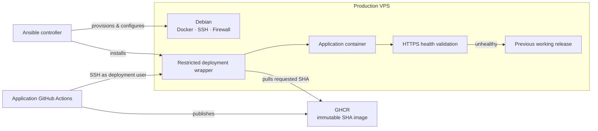

# Ansible VPS Template

Production VPS provisioning and deployment template designed to work with
[Symfony App Template](https://github.com/lapkinu/symfony-app-template).

The template is built around one idea:

**the production server should be reproducible, restricted, and ready to run immutable application releases without becoming part of the application build process.**

A fresh Debian VPS can be prepared through Ansible and then used as the stable
server-side half of the deployment pipeline.

Application CI builds the release.

The VPS runs it.

## Why This Template Exists

Application deployment and server provisioning solve different problems.

The application repository should be responsible for producing a tested release.
The infrastructure repository should be responsible for deciding how that release
is allowed to reach and run on the server.

This template establishes that boundary explicitly.

The production server:

* does not clone the application repository;
* does not build application source;
* does not give the CI deployment user unrestricted `sudo`;
* does not give the CI deployment user direct access to the Docker socket.

Instead, Ansible prepares the VPS once and installs a restricted deployment
mechanism that application CI can safely invoke for future releases.

Normal application releases therefore do not require rerunning Ansible.

## Architecture



The operational path after provisioning is intentionally simple:

```text
GitHub Actions → restricted deployment command → immutable GHCR image → Docker Compose → health validation
```

If the new release becomes healthy, deployment completes.

If deployment fails after the running release has already been modified, the
server-side deployment mechanism restores the previous working release.

## What Is Included

The template provisions and configures:

* administrator and deployment users;
* SSH hardening;
* Docker Engine and Docker Compose;
* host firewall rules;
* Docker traffic firewall rules;
* application runtime configuration;
* production secrets;
* GHCR authentication;
* a dedicated CI deployment SSH key;
* a restricted `sudo` deployment wrapper;
* serialized deployments;
* application health validation;
* automatic rollback.

The tested production baseline is:

* Debian 13;
* `amd64`;
* Docker Engine;
* Docker Compose;
* GitHub Actions;
* GitHub Container Registry.

The template is intentionally focused on a single VPS deployment model rather
than trying to cover every operating system, cloud provider, registry, or
orchestration platform.

## Prerequisites

On the Ansible controller:

* Ansible;
* Docker, used to generate the Caddy Basic Auth password hash;
* an SSH key for server administration;
* a separate SSH key pair for CI deployment.

The target server should provide:

* a fresh Debian 13 installation;
* initial SSH access as `root`;
* DNS records for the production application hostnames before application
  deployment.

For private GHCR images, a GitHub credential with permission to pull the
application package is also required.

## Quick Start

### 1. Install Ansible dependencies

```console
ansible-galaxy collection install -r requirements.yml
```

### 2. Configure the production host

Edit:

```text
inventory/production/hosts.yml
```

Set the VPS address:

```yaml
all:
  hosts:
    production:
      ansible_host: 203.0.113.10
```

Replace the documentation address with the actual production server IP address
or hostname.

### 3. Configure the project

Edit:

```text
inventory/production/group_vars/all/main.yml
```

At minimum, configure the application-specific values:

```yaml
deployment_app_name: example-app

deployment_registry_username: username

deployment_image_repository: ghcr.io/username/example-app

deployment_main_server_name: example.com

deployment_server_name: dev.example.com

deployment_basic_auth_username: dev
```

`deployment_app_name` is the server-side deployment identifier.

It must match `DEPLOY_APP` in the companion application repository.

The default deployment user is:

```text
deploy
```

and therefore the application repository normally uses:

```text
DEPLOY_USER=deploy
```

`deployment_image_repository` must point to the same GHCR repository that is
published by the application CI workflow.

## SSH Keys

Two separate SSH identities are used.

### Administrator key

The administrator key is used for infrastructure management through Ansible.

The default configuration expects a public key similar to:

```yaml
admin_ssh_public_key_path: "~/.ssh/id_rsa.pub"
admin_ssh_public_key: "{{ lookup('file', admin_ssh_public_key_path) }}"
```

If another key is used, update the path accordingly.

For example:

```yaml
admin_ssh_public_key_path: "~/.ssh/id_ed25519.pub"
```

The configured path must point to a public key, never to the private key.

### CI deployment key

GitHub Actions uses a separate SSH key pair to connect as the unprivileged
deployment user.

Create it on the trusted Ansible controller:

```console
mkdir -p ~/.ssh/github-actions
chmod 700 ~/.ssh/github-actions

ssh-keygen \
  -t ed25519 \
  -f ~/.ssh/github-actions/deploy \
  -C "github-actions-deploy"
```

For the current deployment workflow, leave the passphrase empty.

This creates:

```text
~/.ssh/github-actions/deploy      private key
~/.ssh/github-actions/deploy.pub  public key
```

Configure the public key in `main.yml`:

```yaml
deploy_ci_ssh_public_key_path: "~/.ssh/github-actions/deploy.pub"
deploy_ci_ssh_public_key: "{{ lookup('file', deploy_ci_ssh_public_key_path) }}"
```

Ansible installs the public key on the VPS.

The corresponding private key is later stored in the application repository's
GitHub `production` Environment as:

```text
DEPLOY_SSH_PRIVATE_KEY
```

Do not reuse the administrator key for CI deployment.

Do not commit either private key.

## Production Secrets

Create the local Vault file from the provided example:

```console
cp \
  inventory/production/group_vars/all/vault.example.yml \
  inventory/production/group_vars/all/vault.yml
```

Configure:

```yaml
vault_ghcr_token: "replace-with-ghcr-token"
vault_app_secret: "replace-with-generated-app-secret"
vault_basic_auth_password_hash: '<replace-with-generated-bcrypt-hash>'
vault_caddy_mercure_jwt_secret: "replace-with-generated-mercure-secret"
```

### GHCR credential

`vault_ghcr_token` must contain a GitHub credential that is allowed to pull the
configured private GHCR image.

For a classic GitHub personal access token, the minimum package permission is:

```text
read:packages
```

Additional repository or organization restrictions may require corresponding
access configuration.

### Application secrets

Generate the Symfony application secret:

```console
openssl rand -hex 32
```

Generate a separate Mercure JWT secret the same way:

```console
openssl rand -hex 32
```

Do not reuse the same value for both secrets.

### Basic Auth password

Choose the password that will protect the production application hostname and
generate its bcrypt hash:

```console
docker run --rm caddy:2-alpine \
  caddy hash-password --plaintext 'replace-with-a-strong-password'
```

Store the returned value as:

```yaml
vault_basic_auth_password_hash: '<generated-bcrypt-hash>'
```

Store the raw bcrypt hash.

Do not manually replace `$` with `$$`; the deployment configuration performs the
escaping required by Docker Compose.

The Basic Auth password and the Ansible Vault password are different
credentials with different purposes.

### Encrypt the Vault

After all values have been configured:

```console
ansible-vault encrypt inventory/production/group_vars/all/vault.yml
```

For later changes:

```console
ansible-vault edit inventory/production/group_vars/all/vault.yml
```

`vault.yml` is ignored by Git and must not be committed.

##  Application Launch Modes

The deployment supports two application modes: pre-launch and production.

These modes are controlled through Ansible variables in inventory/production/group_vars/all/main.yml.

Pre-launch mode

Use this mode while the application is being developed and prepared for public release.
```yml
deployment_landing_enabled: true
deployment_basic_auth_enabled: true
```
```yml
deployment_main_server_name: example.com
deployment_server_name: dev.example.com
```

Expected behavior:

example.com serves a static landing page.
dev.example.com serves the Symfony application behind HTTP Basic Authentication.

This allows the public domain to display a landing page while the application remains protected on a separate hostname.

Production mode

When the application is ready for public release, update the configuration:

```yml
deployment_landing_enabled: false
deployment_basic_auth_enabled: false
```
```yml
deployment_server_name: example.com
```

Expected behavior:

example.com serves the Symfony application directly.
The landing page is disabled.
HTTP Basic Authentication is disabled for the application.

The production hostname becomes the primary application hostname.

Switching modes

To switch from pre-launch to production:

Update the variables in inventory/production/group_vars/all/main.yml.
Set deployment_landing_enabled and deployment_basic_auth_enabled to false.
Change deployment_server_name to the production hostname.
Apply the updated configuration using the appropriate Ansible deployment workflow.
Verify that the application is accessible and the health check passes.

Keep the hostname settings consistent with your DNS records and TLS configuration.

Important: Review the resulting configuration before applying changes to a production server. Disabling Basic Authentication makes the application publicly accessible if no other access controls are configured.

## Provision the VPS

Provisioning happens in two stages.

### Bootstrap

The bootstrap playbook uses the initial root SSH access to prepare the
administrator account:

```console
ansible-playbook playbooks/bootstrap.yml --ask-vault-pass
```

It preserves existing root authorized SSH keys, installs the configured
administrator key, and prepares passwordless `sudo`.

### Server configuration

After bootstrap:

```console
ansible-playbook playbooks/server.yml --ask-vault-pass
```

The server playbook configures the remaining production environment, including:

* users;
* SSH hardening;
* Docker;
* firewall rules;
* runtime configuration;
* deployment access;
* the server-side deployment mechanism.

The playbooks are intended to be rerunnable when infrastructure configuration
changes.

## Verify Deployment SSH Access

Before configuring GitHub Actions, verify the dedicated CI key from the trusted
controller:

```console
ssh \
  -i ~/.ssh/github-actions/deploy \
  -o IdentitiesOnly=yes \
  deploy@<DEPLOY_HOST> \
  'id'
```

The connection should authenticate using the dedicated key and report the
unprivileged deployment user.

## Configure GitHub Deployment

In the companion application repository, create a GitHub Environment named:

```text
production
```

Configure these environment variables:

```text
DEPLOY_HOST=<server-address>
DEPLOY_USER=deploy
DEPLOY_APP=<deployment_app_name>
```

Configure these environment secrets:

```text
DEPLOY_SSH_PRIVATE_KEY
DEPLOY_SSH_KNOWN_HOSTS
```

### Deployment private key

Copy the complete private key:

```console
cat ~/.ssh/github-actions/deploy
```

Store the entire OpenSSH block, including its `BEGIN` and `END` lines, as:

```text
DEPLOY_SSH_PRIVATE_KEY
```

Do not base64-encode it.

### Verify the VPS host key

GitHub Actions must also verify that it is connecting to the expected VPS.

Through an already trusted administrator connection, inspect the server's
Ed25519 host-key fingerprint:

```console
ssh admin@<DEPLOY_HOST>

sudo ssh-keygen \
  -lf /etc/ssh/ssh_host_ed25519_key.pub \
  -E sha256

exit
```

Then collect the public host key from the trusted controller:

```console
ssh-keyscan -t ed25519 <DEPLOY_HOST> 2>/dev/null \
  > /tmp/deploy-known-hosts

ssh-keygen \
  -lf /tmp/deploy-known-hosts \
  -E sha256
```

The fingerprints must match.

After verification:

```console
cat /tmp/deploy-known-hosts
```

Store the complete resulting line as:

```text
DEPLOY_SSH_KNOWN_HOSTS
```

Never copy the server's private host key.

## Enable Production Deployment

Application CI can build and publish production images immediately, but actual
deployment is disabled by default.

Only after the VPS and the GitHub `production` Environment have been configured,
create the following **repository-level Actions variable** in the application
repository:

```text
DEPLOY_ENABLED=true
```

Create it under:

```text
Settings → Secrets and variables → Actions → Variables
```

Do not create `DEPLOY_ENABLED` as a variable of the `production` GitHub
Environment.

If it is missing or its value is anything other than the exact string `true`,
the deployment job is skipped.

This allows a repository created from the application template to build
production artifacts without automatically receiving permission to deploy them.

## Application and Infrastructure Contract

The companion repositories share a small explicit deployment interface:

```text
DEPLOY_APP                    ↔ deployment_app_name
DEPLOY_USER                   ↔ deployment_user
GHCR image repository         ↔ deployment_image_repository
MAIN_SERVER_NAME              ↔ deployment_main_server_name
SERVER_NAME                   ↔ deployment_server_name
DEPLOY_SSH_PRIVATE_KEY        ↔ deploy_ci_ssh_public_key pair
GET /health                   ↔ deployment_healthcheck_path
```

The values on both sides must describe the same application and deployment
target.

Keeping this interface explicit allows application development and
infrastructure provisioning to evolve independently.

## Deployment Model

Application deployment is initiated by the companion application's GitHub
Actions workflow.

CI connects to the VPS using the restricted deployment user and invokes:

```console
sudo -n /usr/local/sbin/deploy-<DEPLOY_APP> '<40-character-git-sha>'
```

For example, with:

```text
DEPLOY_APP=example-app
```

the server-side command is:

```text
/usr/local/sbin/deploy-example-app
```

The deployment wrapper:

* accepts exactly one 40-character lowercase Git SHA;
* serializes deployments with `flock`;
* pulls the requested immutable GHCR image;
* validates Docker Compose configuration before modifying the running
  application;
* starts the requested release;
* performs the HTTPS application health check;
* restores the previous working release when deployment or health validation
  fails.

The deployment user does not need unrestricted `sudo` or direct Docker access.

The server provisioning layer exposes only the required root-owned deployment
wrapper through `sudo`.

Mutable image tags such as `latest` are not part of this deployment model.

## Runtime Configuration

The main non-secret production values are stored in:

```text
inventory/production/group_vars/all/main.yml
```

Encrypted values are stored in:

```text
inventory/production/group_vars/all/vault.yml
```

Runtime configuration is rendered on the server and kept outside the immutable
application image.

Changing a runtime secret or environment value does not modify the environment
of an already running container.

The application container must be recreated through the deployment mechanism
before the new values take effect.

A runtime-only configuration change does not inherently require a new
application commit. An already published SHA can be deployed again, provided the
server-side deployment implementation recreates the container as expected.

## Security Model

The provisioned server follows a deliberately restricted deployment model:

* direct root SSH login is disabled by the server configuration;
* SSH password authentication is disabled;
* the deployment user is unprivileged;
* the deployment user is not a member of the Docker group;
* the deployment user has no direct access to the Docker socket;
* runtime configuration is root-owned;
* deployment secrets are readable only by root;
* CI can invoke only the configured deployment wrapper through `sudo`;
* deployment input is restricted to a full Git SHA;
* concurrent deployments are serialized;
* SSH host verification is strict;
* host and Docker traffic are protected by firewall configuration.

The application image itself is built by application CI.

The production server remains a deployment target rather than a build
environment.

## Database Migrations

Database provisioning and migrations are not part of the current deployment
contract.

Projects adding a database should define their production database, migration,
backup, and rollback strategy before relying on application-level automatic
migration behavior.

## Operations

Validate the playbooks:

```console
ansible-playbook playbooks/bootstrap.yml --syntax-check
ansible-playbook playbooks/server.yml --syntax-check
```

Inspect the resolved production host configuration:

```console
ansible-inventory --host production --ask-vault-pass
```

Edit encrypted secrets:

```console
ansible-vault edit inventory/production/group_vars/all/vault.yml
```

Reapply infrastructure configuration:

```console
ansible-playbook playbooks/server.yml --ask-vault-pass
```

Normal application releases are deployed by application CI and do not require
rerunning Ansible.

## Companion Application

The intended application repository is:

[Symfony App Template](https://github.com/lapkinu/symfony-app-template)

The two templates provide different halves of the same production workflow.

The application repository tests, builds, publishes, and identifies a release.

The infrastructure repository prepares the VPS and controls how that release is
allowed to run there.

## License

See [LICENSE](LICENSE).
