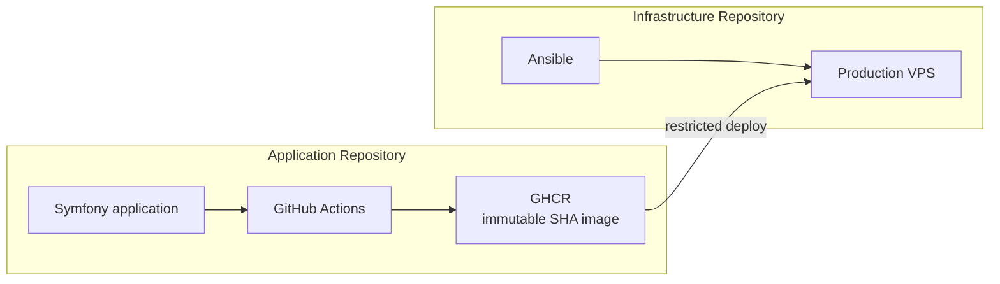
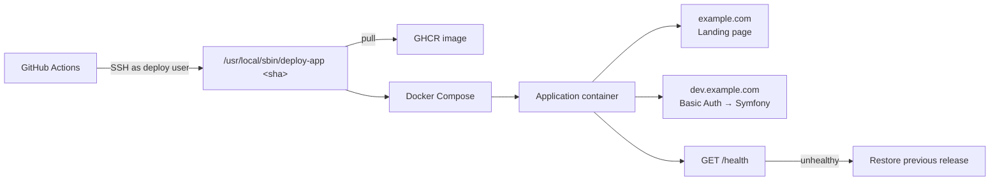

# Ansible VPS Template

Production VPS provisioning and deployment template designed to work with the  
[Symfony App Template](https://github.com/lapkinu/symfony-app-template).

The template is built around one idea:

**A production-ready VPS should be available early in the project lifecycle, so the application can be developed and reviewed through the same path that will later serve the released version.**

A fresh Debian VPS is prepared once with Ansible and then used as the stable server-side half of the deployment pipeline.  
Application CI builds the release. The VPS runs it.

---

## Companion Application

This repository prepares the VPS and controls how releases are deployed.

The companion [Symfony App Template](https://github.com/lapkinu/symfony-app-template)  
builds, tests and publishes the immutable production image.

Together they provide a complete path from early development to a restricted  
production environment that can already be used while the application remains private.

---

## Why This Template Exists

Application deployment and server provisioning solve different problems.

- The application repository is responsible for producing a tested release.
- The infrastructure repository is responsible for deciding how that release is allowed to reach and run on the server.

This template establishes that boundary explicitly.

The production server:

- does not clone the application repository
- does not build application source
- does not give the CI deployment user unrestricted `sudo`
- does not give the CI deployment user direct access to the Docker socket

Ansible prepares the VPS once and installs a restricted deployment mechanism.  
Subsequent application releases do not require re-running Ansible.

---

## Key Features

| Feature                | Description                                                              |
| ---------------------- | ------------------------------------------------------------------------ |
| Restricted deployment  | CI can only invoke one specific command via `sudo`                       |
| Immutable releases     | Only full Git SHAs are accepted                                          |
| Automatic rollback     | Previous working release is restored on health-check failure             |
| Serialized deployments | Concurrent deployments are blocked                                       |
| Pre-launch mode        | Public domain serves a landing page; application stays behind Basic Auth |
| Strong defaults        | Root SSH disabled, password auth disabled, firewall, minimal privileges  |

---

## Architecture

### Separation of responsibilities



The application repository produces the release.  
The infrastructure repository prepares the server and controls how the release is allowed to run.

### Deployment flow



In pre-launch mode the same container serves both the public landing page and the protected application.  
When the application is ready, the public hostname is switched to the Symfony application without changing the deployment model.

---

## What Is Included

- Administrator and deployment users
- SSH hardening
- Docker Engine and Docker Compose
- Host and Docker traffic firewall rules
- Application runtime configuration
- Production secrets (via Ansible Vault)
- GHCR authentication
- Dedicated CI deployment SSH key
- Restricted `sudo` deployment wrapper
- Serialized deployments
- HTTPS health validation
- Automatic rollback

**Tested baseline:** Debian 13 · amd64 · Docker · Docker Compose · GitHub Actions · GHCR

---

## Prerequisites

**Ansible controller:**

- Ansible
- Docker (for generating the Basic Auth password hash)
- Administrator SSH key
- Separate SSH key pair for CI deployment

**Target server:**

- Fresh Debian 13
- Initial root SSH access
- DNS records for the application hostnames

For private GHCR images a GitHub token with `read:packages` is required.

---

## Quick Start

### 1. Install Ansible collections

```console
ansible-galaxy collection install -r requirements.yml
```

### 2. Set the server address

Edit `inventory/production/hosts.yml`:

```yaml
all:
  hosts:
    production:
      ansible_host: 203.0.113.10 # replace with your VPS IP or hostname
```

### 3. Configure SSH keys

Two separate keys are required.

**Administrator key** — used by Ansible for server management.

This is the public key that will be installed for the `admin` user.  
After bootstrap, root SSH login is disabled, so this becomes the main administrative key.

```yaml
admin_ssh_public_key_path: "~/.ssh/id_ed25519.pub"
admin_ssh_public_key: "{{ lookup('file', admin_ssh_public_key_path) }}"
```

Replace the path with the public key you use (or will use) to access the server.  
If you don’t have a key yet, create one and make sure you can connect to the fresh server as `root` with it before running the playbooks.

**CI deployment key** — used only by GitHub Actions to trigger deployments:

```console
mkdir -p ~/.ssh/github-actions
chmod 700 ~/.ssh/github-actions
ssh-keygen -t ed25519 -f ~/.ssh/github-actions/deploy -C "github-actions-deploy"
```

```yaml
deploy_ci_ssh_public_key_path: "~/.ssh/github-actions/deploy.pub"
deploy_ci_ssh_public_key: "{{ lookup('file', deploy_ci_ssh_public_key_path) }}"
```

The private key (`~/.ssh/github-actions/deploy`) will later be stored in the  
application repository as the `DEPLOY_SSH_PRIVATE_KEY` secret.

Do not reuse the administrator key for CI.


### 4. Configure project values

Edit `inventory/production/group_vars/all/main.yml`:

```yaml
deployment_app_name: example-app
# Server-side deployment identifier.
# Must match DEPLOY_APP in the application repository.
# Becomes the deployment command: /usr/local/sbin/deploy-example-app

deployment_registry_username: username
deployment_image_repository: ghcr.io/{{ deployment_registry_username }}/{{ deployment_app_name }}
# Must point to the same GHCR repository published by the application CI.
# Usually derived from the two values above.

deployment_main_server_name: example.com
# Public hostname. In pre-launch mode this serves the landing page.

deployment_server_name: dev.example.com
# Application hostname. In pre-launch mode this is protected by Basic Auth.

deployment_basic_auth_username: dev
```

### 5. Configure secrets

```console
cp inventory/production/group_vars/all/vault.example.yml \
   inventory/production/group_vars/all/vault.yml
```

```yaml
vault_ghcr_token: "github-token-with-read:packages"
vault_app_secret: "generated-secret"
vault_caddy_mercure_jwt_secret: "generated-secret"
vault_basic_auth_password_hash: "<bcrypt-hash>"
```

Generate the required values:

**1. GHCR token (`vault_ghcr_token`)**

A GitHub token (classic or fine-grained) with **only** the `read:packages` permission.  
Required to pull private images from GitHub Container Registry.  
No other scopes are needed.

**2. Application secret (`vault_app_secret`)**

```console
openssl rand -hex 32
```

**3. Mercure JWT secret (`vault_caddy_mercure_jwt_secret`)**

```console
openssl rand -hex 32
```

Use a different value. Do not reuse the same secret for both `vault_app_secret` and `vault_caddy_mercure_jwt_secret`.

**4. Basic Auth password hash (`vault_basic_auth_password_hash`)**

```console
docker run --rm caddy:2-alpine \
  caddy hash-password --plaintext 'your-strong-password'
```

Encrypt the file:

```console
ansible-vault encrypt inventory/production/group_vars/all/vault.yml
```

### 6. Provision the server

```console
ansible-playbook playbooks/bootstrap.yml --ask-vault-pass
```

```console
ansible-playbook playbooks/server.yml --ask-vault-pass
```

`bootstrap.yml` creates the administrator account.  
`server.yml` configures the rest of the production environment.

### 7. Verify deployment access

```console
ssh -i ~/.ssh/github-actions/deploy \
    -o IdentitiesOnly=yes \
    deploy@YOUR_SERVER \
    'id'
```

The connection should succeed as the unprivileged `deploy` user.

### 8. Configure the application repository

In the companion application repository create a GitHub Environment named `production`.

Location: Settings → Environments → New environment.

**Environment variables:**

| Variable      | Value                          | Source                  |
| ------------- | ------------------------------ | ----------------------- |
| `DEPLOY_HOST` | VPS IP or hostname             | same as `ansible_host`  |
| `DEPLOY_USER` | `deploy`                       | default deployment user |
| `DEPLOY_APP`  | value of `deployment_app_name` | must match exactly      |

**Environment secrets:**

**1. `DEPLOY_SSH_PRIVATE_KEY`**

Copy the entire private key file:

```console
cat ~/.ssh/github-actions/deploy
```

Paste the full output (including the `BEGIN` and `END` lines) into the secret.

**2. `DEPLOY_SSH_KNOWN_HOSTS`**

GitHub Actions must verify that it is connecting to the correct server.

On a machine that has already connected to the server at least once, run:

```console
ssh-keyscan -t ed25519 YOUR_SERVER
```

Example output:

```text
203.0.113.10 ssh-ed25519 AAAAC3NzaC1lZDI1NTE5AAAAIExampleKeyDataHere...
```

Copy the **entire line** and paste it as the value of the `DEPLOY_SSH_KNOWN_HOSTS` secret.

### 9. Enable deployment

Create a **repository-level** Actions variable (not an Environment variable):

```text
DEPLOY_ENABLED=true
```

Location: Settings → Secrets and variables → Actions → Variables.

While this variable is missing or not exactly `true`, the deployment job is skipped.  
This allows the application repository to build and publish images without permission to deploy them.

After the variable and the `production` Environment are configured, open the latest (or the initial) workflow run and re-run the **Deploy production** job.  
This triggers the first real deployment to the VPS.

---

## Application Launch Modes

Controlled by variables in `inventory/production/group_vars/all/main.yml`.

### Pre-launch

```yaml
deployment_landing_enabled: true
deployment_basic_auth_enabled: true

deployment_main_server_name: example.com
deployment_server_name: dev.example.com
```

- `example.com` serves a static landing page
- `dev.example.com` serves the application behind Basic Auth

### Production

To apply the change:
1. Update the variables in `inventory/production/group_vars/all/main.yml`

```yaml
deployment_landing_enabled: false
deployment_basic_auth_enabled: false
```

- Application is served directly on the main domain
- Landing page and Basic Auth are disabled

It is not necessary to change the hostname variables when switching to production mode.

2. Re-run the server playbook:

```console
ansible-playbook playbooks/server.yml --ask-vault-pass
```
3. In the application repository, re-run the Deploy production job (the final stage only) so the new configuration is picked up by the running release.

---

## Deployment Model

CI invokes:

```console
sudo -n /usr/local/sbin/deploy-<app-name> '<40-character-git-sha>'
```

The wrapper:

- accepts only a full Git SHA
- serializes deployments with `flock`
- pulls the immutable image from GHCR
- validates Docker Compose configuration
- starts the release
- runs an HTTPS health check
- restores the previous release on failure

The deployment user has no Docker socket access and no unrestricted `sudo`.

---

## Security Model

- Root SSH login disabled
- Password authentication disabled
- Deployment user is unprivileged and not in the `docker` group
- Runtime configuration and secrets are root-owned
- CI can only call the configured deployment wrapper
- Input is restricted to a full Git SHA
- Concurrent deployments are serialized
- Strict SSH host key verification
- Host and Docker traffic protected by firewall

---

## Runtime Configuration

Non-secret values: `inventory/production/group_vars/all/main.yml`  
Secrets: `inventory/production/group_vars/all/vault.yml`

Runtime configuration is rendered on the server and kept outside the application image.  
Changing a value requires recreating the container through the deployment mechanism.

---

## Database Migrations

Database provisioning and migrations are not part of the current deployment contract.  
Projects that need a database should define their own migration, backup and rollback strategy.

---

## Useful Commands

```console
ansible-playbook playbooks/bootstrap.yml --syntax-check
```

```console
ansible-playbook playbooks/server.yml --syntax-check
```

```console
ansible-inventory --host production --ask-vault-pass
```

```console
ansible-vault edit inventory/production/group_vars/all/vault.yml
```

```console
ansible-playbook playbooks/server.yml --ask-vault-pass
```

Normal application releases are handled by GitHub Actions and do not require re-running Ansible.

---

## License

See [LICENSE](LICENSE).
